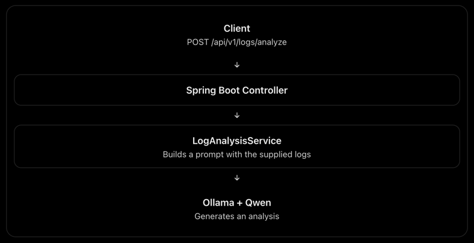
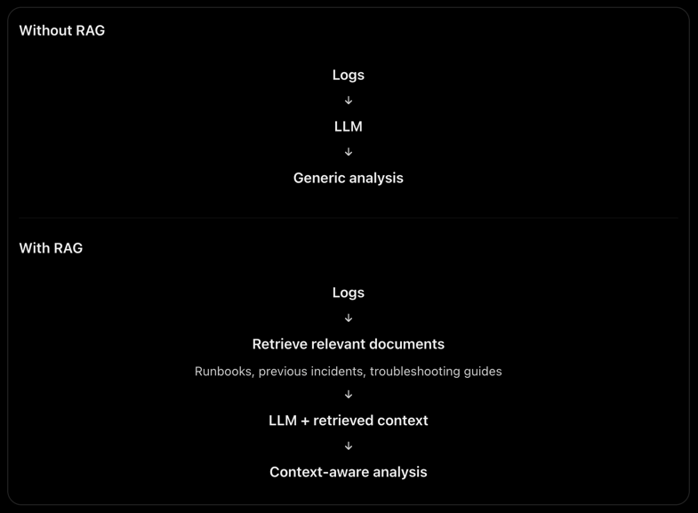

# Log Investigator Using Local AI

## V1 of Application



This is an LLM-powered application, but it has one major limitation:
The model only knows what you provide in the prompt and what it learned during training.

Imagine giving it these logs:

```bash
2026-11-02 10:15:32 ERROR OrderService - Failed to process order
java.net.SocketTimeoutException: Read timed out
```

It might suggest checking network latency, downstream services, and timeout configurations.

> But what if your company already has a troubleshooting document saying: OrderService communicates with PaymentService.
> PaymentService has a configured read timeout of 3 seconds. If payment requests time out, first check the payment
> provider's availability.

Your current application has no way of retrieving that document.

**This is where RAG comes in.**

---

## V2 of Application: Implementing RAG (Retrieval-Augmented Generation)

